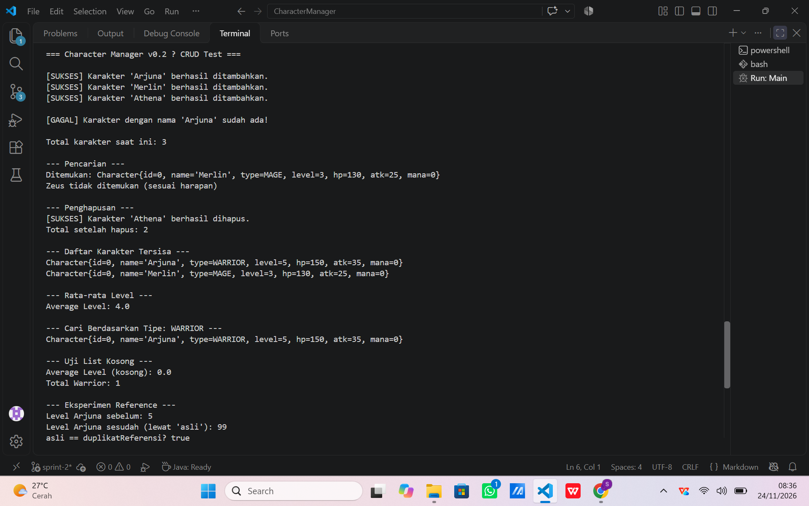
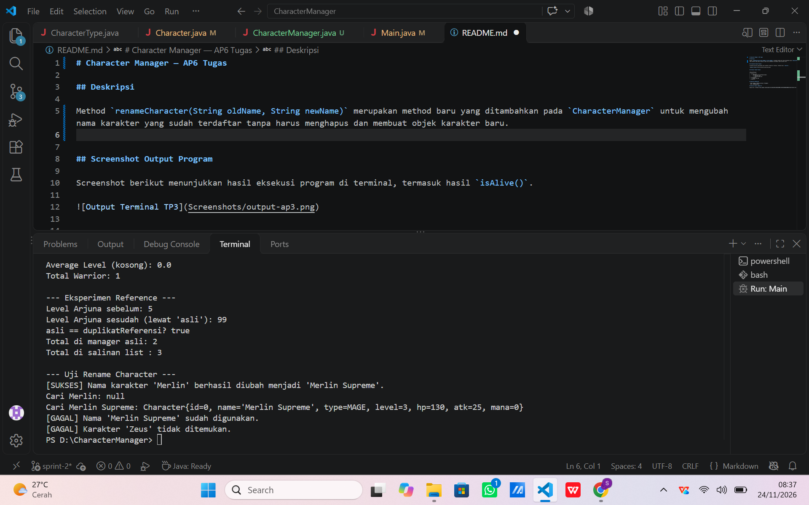

# Character Manager — AP6 Tugas

## Deskripsi

Method `renameCharacter(String oldName, String newName)` merupakan method baru yang ditambahkan pada `CharacterManager` untuk mengubah nama karakter yang sudah terdaftar tanpa harus menghapus dan membuat objek karakter baru.

## Fitur TP5

- Create: Menambahkan karakter ke dalam list.
- Read: Mencari karakter berdasarkan nama dan menampilkan daftar karakter.
- Delete: Menghapus karakter berdasarkan nama.
- Validasi nama duplikat saat menambahkan karakter.
- `getAverageLevel()`: Menghitung rata-rata level seluruh karakter.
- `findByType()`: Mencari karakter berdasarkan tipe.
- Defensive Copy: Mengembalikan salinan list karakter agar list internal tidak dapat diubah secara langsung dari luar.
- Eksperimen Reference: Membuktikan bahwa dua variabel dapat merujuk pada objek yang sama.
- `renameCharacter()`: Mengubah nama karakter dengan validasi.

## Screenshot Output Program

### 1. Output CRUD dan Fitur Tambahan

Screenshot berikut menunjukkan hasil pengujian penambahan karakter, pencarian, validasi duplikat, penghapusan karakter, menampilkan karakter tersisa, perhitungan rata-rata level, pencarian berdasarkan tipe, serta pengujian list kosong.

### 2. Eksperimen Reference, Defensive Copy, dan Rename Character

Screenshot berikut menunjukkan eksperimen Reference dengan dua variabel yang menunjuk objek yang sama, pengujian Defensive Copy, serta pengujian method `renameCharacter()` termasuk validasi nama duplikat dan karakter yang tidak ditemukan.

## Bagian C - Method Baru

### `renameCharacter(String oldName, String newName)`

Method `renameCharacter()` ditambahkan pada class `CharacterManager` untuk mengubah nama karakter yang sudah terdaftar tanpa perlu menghapus dan membuat objek karakter baru.

Method ini menjaga Encapsulation karena proses pencarian dan perubahan nama dilakukan melalui method yang tersedia di dalam class. `CharacterManager` tidak mengekspos ArrayList internal secara langsung. Perubahan nama dilakukan melalui setter `setName()` pada objek `Character`.

Validasi yang diterapkan:

- Memastikan karakter dengan nama lama ditemukan.
- Memastikan nama baru tidak kosong.
- Memastikan nama baru tidak digunakan oleh karakter lain.
- Perubahan hanya dilakukan jika seluruh validasi berhasil.

### Rasional

Method `renameCharacter()` dipilih karena mempermudah pengelolaan data karakter ketika terjadi perubahan nama. Nama karakter dapat diperbarui tanpa membuat objek baru, sehingga atribut lainnya seperti level, HP, attack power, dan mana tetap dipertahankan.

Validasi bentrok nama diterapkan untuk menjaga konsistensi data dan mencegah adanya karakter dengan nama yang sama. Implementasi ini mendukung prinsip Encapsulation dalam Object-Oriented Programming (OOP).

### Pengujian Method

| Skenario | Hasil |
|---|---|
| Mengubah nama Merlin menjadi Merlin Supreme | Berhasil |
| Mencari nama lama Merlin | Tidak ditemukan (`null`) |
| Mencari nama baru Merlin Supreme | Ditemukan |
| Mengubah nama menjadi nama yang sudah digunakan | Ditolak |
| Mengubah nama karakter yang tidak ditemukan (Zeus) | Ditolak |

Seluruh skenario pengujian berhasil dijalankan melalui `Main.java`.

## Identitas Mahasiswa

- Nama lengkap: **Sharon Caroline  Pardede**
- NIM: **253303621274**

## Analisis Desain (Bagian D)

Google Docs: **(https://docs.google.com/document/d/1yYdo21ZE7nsQV2AhI6MQIll55f2BvhbNuB61EUNBLZk/edit?tab=t.0)**