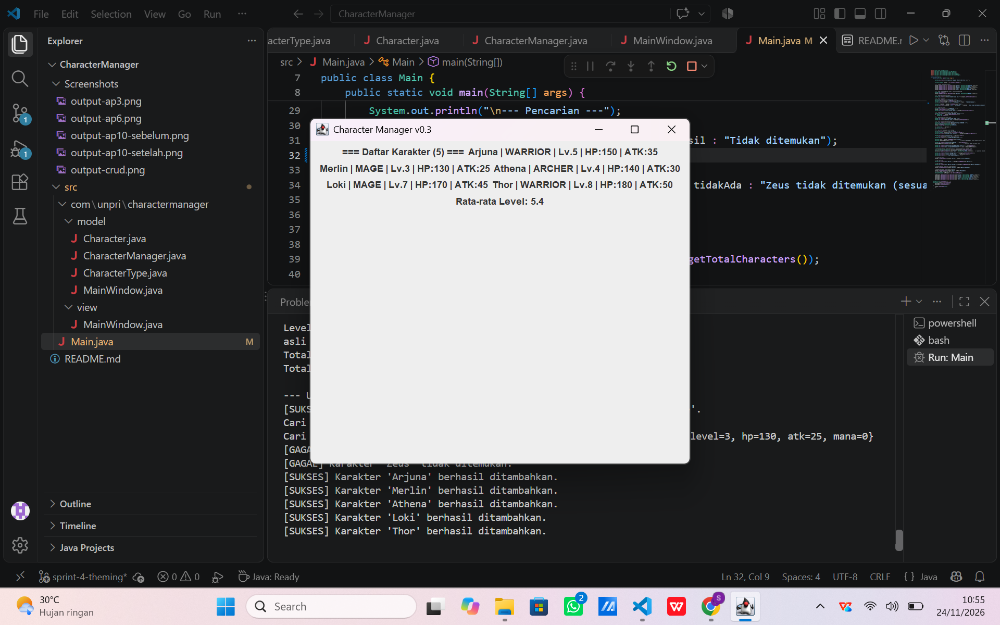
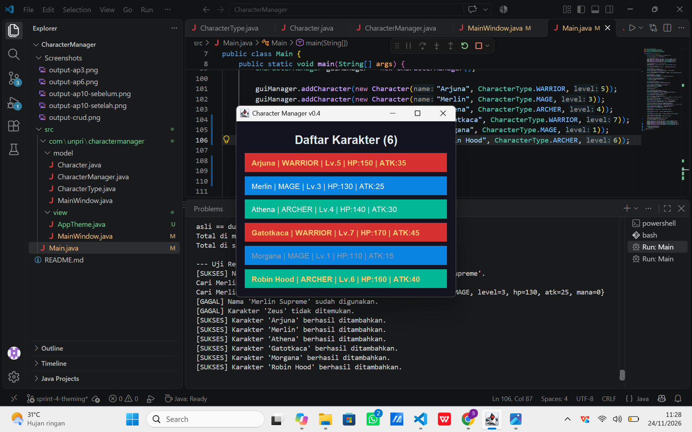

# Character Manager — AP13 Tugas

## Deskripsi

Pada AP13 ini, dilakukan penyempurnaan tampilan aplikasi Character Manager dari versi v0.3 menjadi v0.4 dengan menerapkan konsep centralized theming. Pengaturan warna, font, dan border dipusatkan ke dalam class AppTheme agar tampilan lebih konsisten dan mudah dikelola. Tampilan kartu karakter juga diperbarui dengan warna berdasarkan role, tooltip informasi karakter, serta penekanan karakter dengan level tinggi. Selain itu, dilakukan penambahan beberapa properti antarmuka untuk meningkatkan kejelasan informasi dan memberikan tampilan yang lebih interaktif.

## Screenshot Output Program

### 1. Tampilan Sebelum (v0.3)

Pada versi v0.3, aplikasi Character Manager masih menggunakan tampilan dasar sebelum penerapan tema terpusat. Tampilan karakter belum memiliki penyempurnaan visual seperti warna kartu berdasarkan role dan penekanan teks berdasarkan level. Versi ini digunakan sebagai pembanding untuk melihat perubahan tampilan setelah proses theming.

### 2. Tampilan Setelah (v0.4)

Pada versi v0.4, tampilan aplikasi telah diperbarui menggunakan AppTheme sebagai pusat pengaturan warna, font, dan border. Setiap kartu karakter memiliki warna berdasarkan role, sedangkan karakter dengan level 5 ke atas ditampilkan menggunakan teks emas dan tebal. Tooltip juga menampilkan informasi role, HP, dan ATK, serta karakter Level 1 dibuat nonaktif sehingga terlihat lebih redup dibandingkan karakter lainnya.

## 3. Alasan Warna Disimpan di AppTheme

Warna disimpan di class AppTheme, bukan di class Character, karena warna merupakan bagian dari tampilan (presentation), bukan data inti karakter. Class Character seharusnya hanya bertanggung jawab mengelola data seperti nama, tipe, level, HP, dan attack power. Dengan memusatkan warna di AppTheme, perubahan tampilan dapat dilakukan tanpa mengubah class model. Pemisahan ini membuat kode lebih terstruktur, konsisten, dan mudah dipelihara.

## 4. Properti Tambahan

### a. Tooltip Detail HP dan ATK

Tooltip menampilkan informasi role, HP, dan ATK ketika kursor diarahkan ke kartu karakter. Properti ini dipilih agar pengguna dapat mengetahui detail karakter dengan mudah tanpa membuat tampilan utama terlalu penuh dengan informasi.

### b. Karakter Level 1 Nonaktif

Karakter dengan Level 1 dinonaktifkan menggunakan setEnabled(false). Properti ini dipilih untuk memberikan pembeda visual terhadap karakter dengan level paling rendah sekaligus menunjukkan status karakter yang belum aktif.

### 5. Google Docs – Bagian D

Link Google Docs: (https://docs.google.com/document/d/1BlCfHTOSXwXQEibUCTakaCCLW-2-DNsKCJT1Lels13A/edit?tab=t.0)

## Identitas Mahasiswa

- Nama lengkap: **Sharon Caroline  Pardede**
- NIM: **253303621274**
