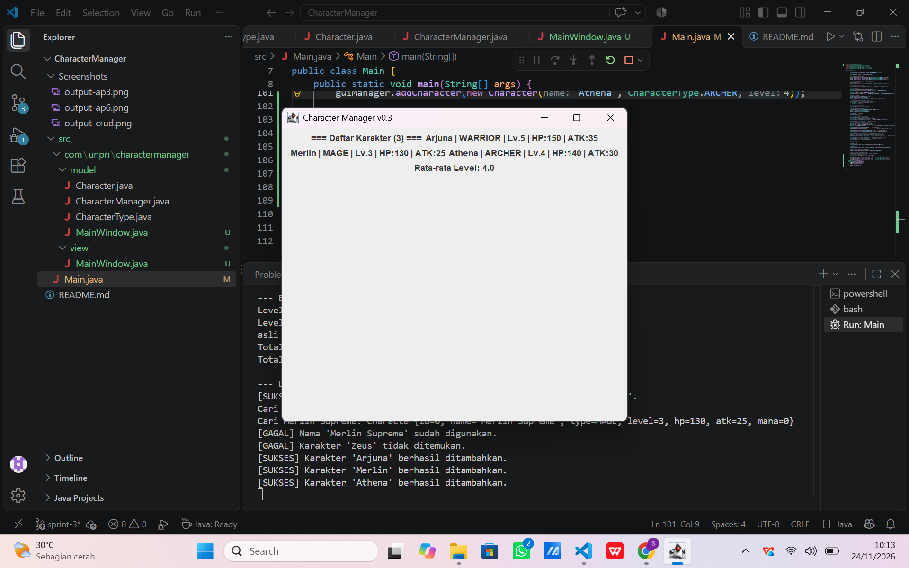
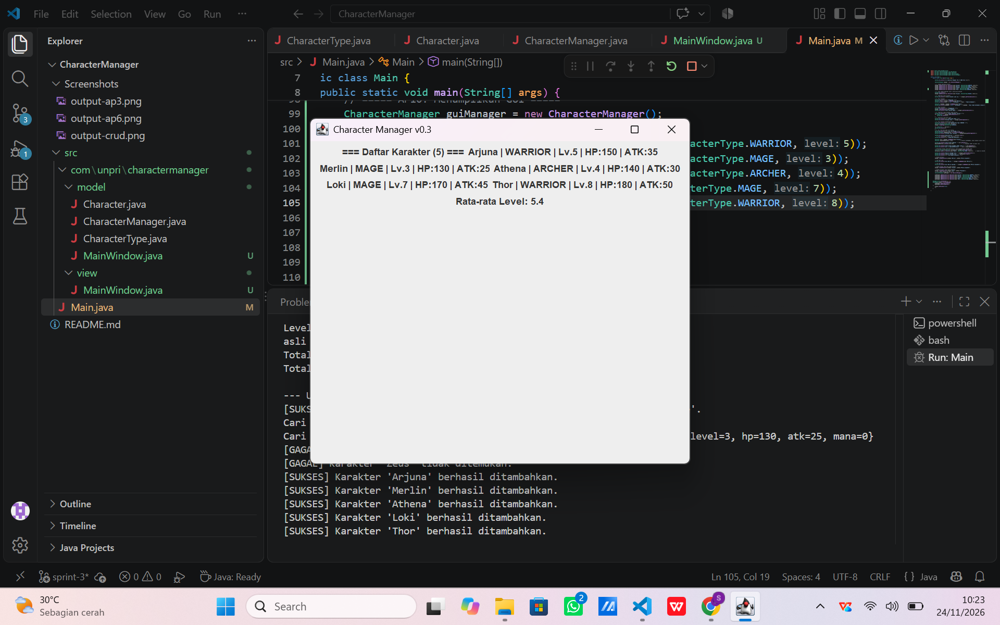

# Character Manager — AP10 Tugas

## Deskripsi

Pada AP10, aplikasi Character Manager dikembangkan dari program berbasis console menjadi aplikasi GUI menggunakan Java Swing. Pengembangan dilakukan dengan membuat class MainWindow pada package view yang mewarisi JFrame dan bertugas menampilkan daftar karakter dalam bentuk JLabel. Data karakter diterima dari Main melalui CharacterManager, sehingga tampilan tidak membuat data karakter sendiri, melainkan menampilkan data yang telah dikelola oleh Model. Pada mini-challenge, aplikasi juga menampilkan statistik rata-rata level karakter yang diperoleh melalui getAverageLevel() dari CharacterManager, serta menguji perubahan statistik setelah penambahan karakter baru.

## Fitur TP5

-Menampilkan GUI (Graphical User Interface) menggunakan Java Swing.
-Membuat MainWindow sebagai jendela utama aplikasi yang mewarisi JFrame.
-Menampilkan daftar karakter secara dinamis menggunakan JLabel berdasarkan data dari CharacterManager.
-Menampilkan jumlah karakter pada judul jendela daftar karakter.
-Menampilkan informasi setiap karakter berupa nama, tipe, level, HP, dan Attack Power.
-Menampilkan statistik rata-rata level karakter menggunakan CharacterManager.getAverageLevel().
-Menguji perluasan data dengan menambahkan karakter baru dan memastikan statistik rata-rata level ikut berubah.

## Screenshot Output Program

### 1. Sebelum (3 Karakter)

Menampilkan kondisi awal GUI sebelum penambahan karakter baru, dengan 3 karakter dan rata-rata level 4.0.

### 2. Setelah (5 Karakter)

Menampilkan GUI setelah penambahan Loki dan Thor, dengan total 5 karakter dan rata-rata level 5.4.

## Aliran Data dan MVC

Program dimulai dari Main yang membuat objek CharacterManager dan menambahkan data karakter ke dalamnya. CharacterManager berperan sebagai Model yang mengelola koleksi karakter serta menghitung rata-rata level menggunakan method getAverageLevel(). Selanjutnya, Main mengirimkan daftar karakter dan nilai rata-rata level kepada MainWindow melalui constructor. MainWindow berperan sebagai View yang menampilkan data karakter dan statistik rata-rata level menggunakan komponen GUI Swing, sehingga pengelolaan data dan tampilan dipisahkan sesuai konsep MVC.

## Karakter Baru

| Nama | Tipe | Level | Alasan Pemilihan |
|---|---|---:|---|
| Loki | MAGE | 7 | Karakter sihir dengan level lebih tinggi untuk menambah variasi kekuatan dan kemampuan Mage dalam koleksi. |
| Thor | WARRIOR | 8 | Karakter petarung dengan level tinggi untuk mewakili kekuatan Warrior dan menambah variasi level karakter. |
Penambahan Loki dan Thor meningkatkan jumlah karakter dari 3 menjadi 5. Perubahan data tersebut juga memengaruhi rata-rata level karakter dari 4.0 menjadi 5.4.

## Identitas Mahasiswa

- Nama lengkap: **Sharon Caroline  Pardede**
- NIM: **253303621274**

## Analisis Desain (Bagian D)

Google Docs: **(https://docs.google.com/document/d/1WVmngzsOWoh9T_Mm46afnY-ibliMNr3sEPrIgVUH9A4/edit?tab=t.0)**