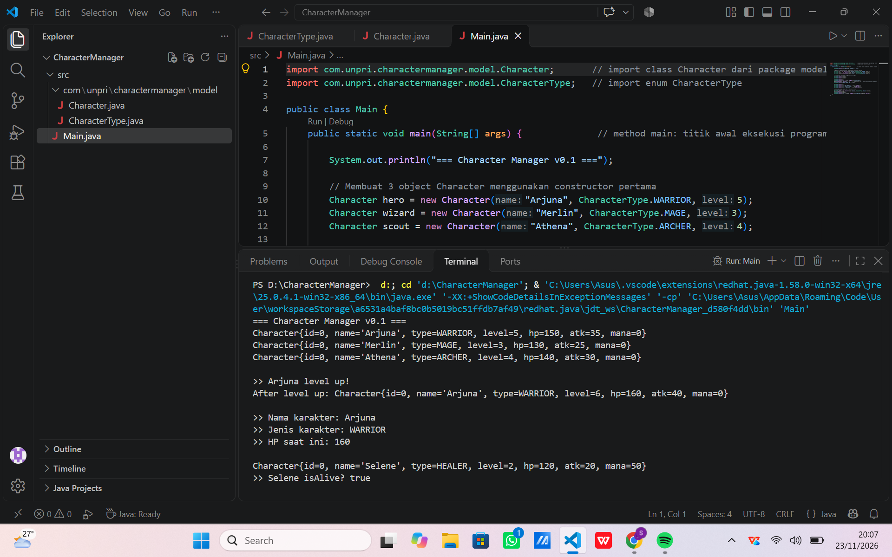

# Character Manager — AP3 Tugas

## Deskripsi

Character Manager adalah aplikasi Java sederhana yang dibuat untuk tugas TP3 mata kuliah Java Visual. Program menerapkan konsep OOP seperti class, enum, dua constructor, dan encapsulation untuk membuat karakter dengan jenis dan level tertentu. Pada tugas ini ditambahkan atribut `mana` dengan validasi tidak boleh negatif, serta method `isAlive()` untuk memeriksa status hidup karakter.

## Screenshot Output Program

Screenshot berikut menunjukkan hasil eksekusi program di terminal, termasuk hasil `isAlive()`.




## Struktur Folder Project

```
CharacterManager/
|-- src/
|   |-- Main.java
|   `-- com/unpri/charactermanager/model/
|       |-- Character.java
|       `-- CharacterType.java
|-- Screenshots/
|   `-- output-tp3.png
`-- README.md
```

## Identitas Mahasiswa

- Nama lengkap: **Sharon Caroline  Pardede**
- NIM: **253303621274**

## Analisis Desain (Bagian D)

Google Docs: **(https://docs.google.com/document/d/1yYdo21ZE7nsQV2AhI6MQIll55f2BvhbNuB61EUNBLZk/edit?tab=t.0)**