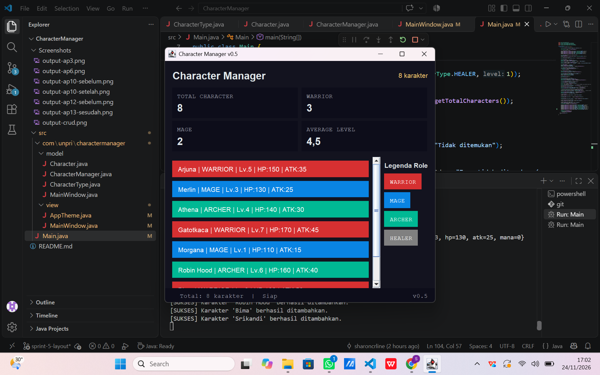
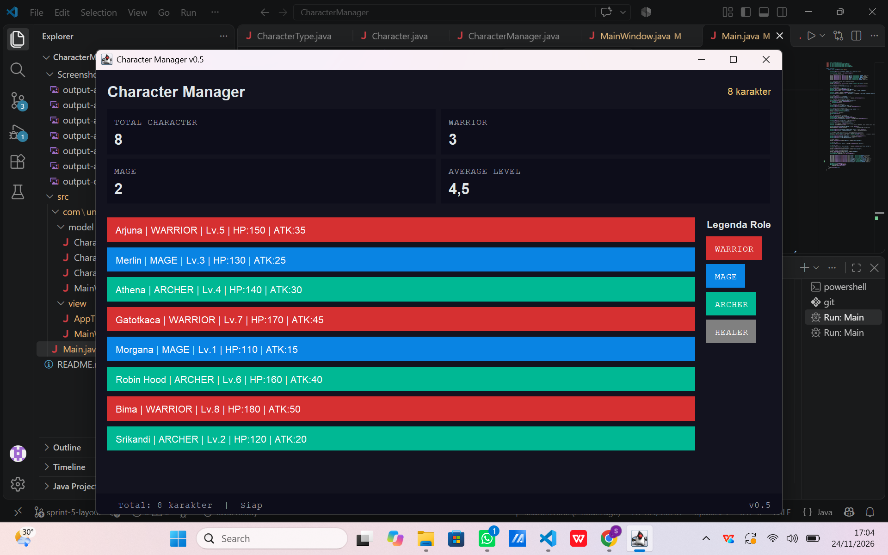
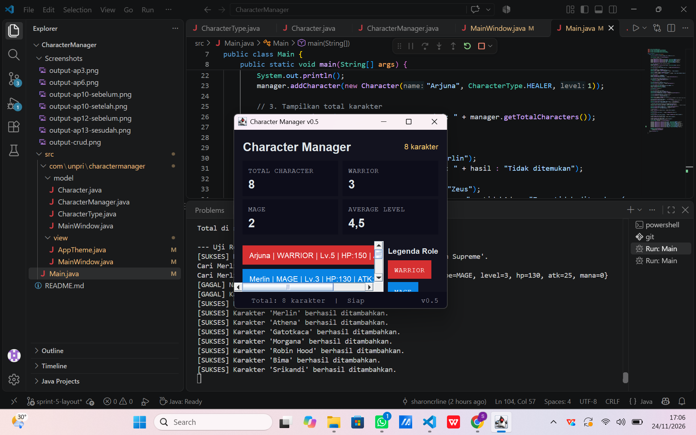

# Character Manager — AP13 Tugas

## Deskripsi

Pada AP16, aplikasi Character Manager dikembangkan menggunakan BorderLayout sebagai layout utama yang membagi tampilan menjadi empat area, yaitu NORTH, CENTER, EAST, dan SOUTH. Panel NORTH berisi header dan panel statistik tambahan menggunakan BorderLayout dan GridLayout 2x2, panel CENTER menampilkan daftar karakter di dalam JScrollPane, panel EAST menampilkan legenda role dengan BoxLayout, dan panel SOUTH menampilkan status aplikasi di kiri serta versi v0.5 di kanan. Panel statistik dipilih agar informasi jumlah karakter dan role dapat dilihat secara ringkas dan terstruktur, sedangkan FlowLayout ditolak untuk panel statistik karena susunannya tidak menjamin posisi empat informasi yang konsisten. Pengujian resize dilakukan pada ukuran awal, jendela yang dilebarkan, dan jendela yang dikecilkan hingga scrollbar muncul untuk mengamati kemampuan layout menyesuaikan ruang.

## Screenshot Output Program

### 1. Jendela Normal

Menampilkan tampilan Character Manager pada ukuran jendela awal setelah aplikasi dijalankan. Seluruh panel utama, panel statistik, legenda role, daftar karakter, dan status bar terlihat pada layout awal.

### 2. Jendela Dilebarkan

Jendela aplikasi diperlebar untuk mengamati perubahan ruang pada layout. Area CENTER menyesuaikan ruang yang tersedia, sementara panel legenda tetap berada di sisi kanan dan status bar tetap berada di bagian bawah.

### 3. Jendela Dikecilkan

Jendela aplikasi diperkecil hingga area daftar karakter tidak dapat menampilkan seluruh data sekaligus. JScrollPane menampilkan scrollbar sehingga karakter lainnya tetap dapat diakses dengan menggulir daftar.

## 3. Wireframe
NORTH — Header
Character Manager　　　　　　　　　　　　　　　　　8 karakter

| NORTH — Statistics (GridLayout 2×2) |
|:---|
| Total Character: 8　　|　Warrior: 3 |
| Mage: 3　　　　　　　|　Average Level: 4.5 |
EAST — Legenda Role	CENTER — Character List (JScrollPane)
Warrior	Arjuna — Lv. 5
Mage	Merlin — Lv. 3
Archer	Athena — Lv. 4
	Gatotkaca — Lv. 7
	Morgana — Lv. 1
	Artemis — Lv. 6
	Bima — Lv. 8
	Circe — Lv. 2
	↕ Scrollbar

SOUTH — Status Bar
Total: 8 karakter | Siap　　　　　　　　　　　　　　　　　v0.5

## 4. Struktur Panel dan Alasan Pemilihan Layout

Aplikasi Character Manager menggunakan BorderLayout sebagai layout utama yang membagi jendela menjadi NORTH, CENTER, EAST, dan SOUTH. Panel NORTH terdiri dari panel header dan panel statistik yang disusun menggunakan BorderLayout, sedangkan panel statistik menggunakan GridLayout 2x2 agar empat informasi statistik tersusun rapi. Panel CENTER berisi daftar karakter yang dimasukkan ke JPanel dan dibungkus JScrollPane agar daftar dapat digulir ketika ruang tampilan terbatas, sedangkan panel EAST menggunakan BoxLayout dengan arah vertikal untuk menyusun legenda role. Panel SOUTH menggunakan BorderLayout dengan teks status di kiri dan versi aplikasi v0.5 di kanan.

## 5. Alasan Pemilihan Layout dan Layout yang Ditolak

Panel statistik dipilih sebagai panel tambahan karena memberikan informasi ringkas mengenai jumlah karakter dan distribusi role, sehingga pengguna dapat melihat informasi utama tanpa harus membaca seluruh daftar. GridLayout 2x2 dipilih karena setiap statistik memiliki ukuran kotak yang konsisten dan tersusun seimbang. FlowLayout ditolak untuk panel statistik karena susunan komponennya dapat berubah mengikuti ruang yang tersedia dan tidak menghasilkan grid tetap empat kotak. GridLayout juga tidak dipilih sebagai layout utama karena pembagian ruang yang seragam pada seluruh region tidak sesuai dengan kebutuhan daftar karakter, legenda, header, dan status bar yang memiliki fungsi serta ukuran berbeda.

### 6. Google Docs – Bagian D

Link Google Docs: (https://docs.google.com/document/d/1-JaRKtNzQc1xXzvFG3SHxZ1jcrnBT79qrUipQl1pBtk/edit?tab=t.0)

## Identitas Mahasiswa

- Nama lengkap: **Sharon Caroline  Pardede**
- NIM: **253303621274**
