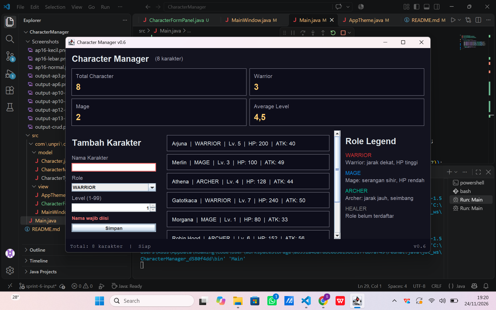
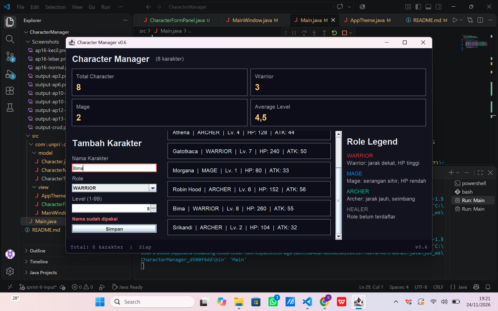
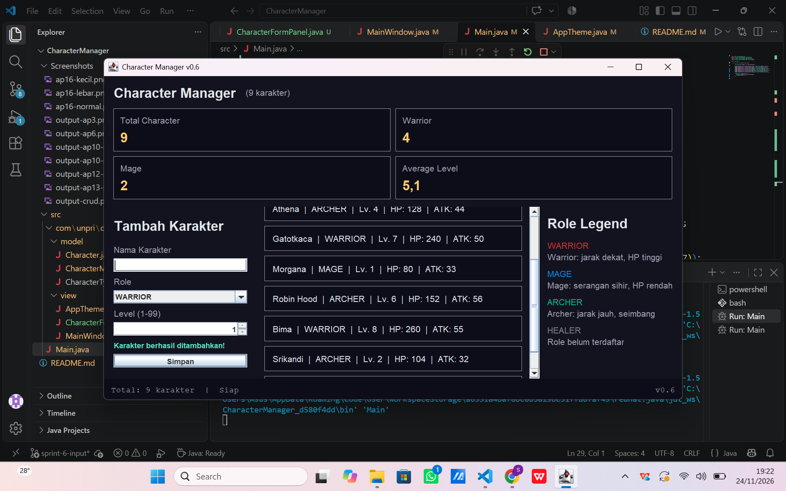

# Character Manager — AP13 Tugas

## Deskripsi

Pada AP16, aplikasi Character Manager dikembangkan menggunakan BorderLayout sebagai layout utama yang membagi tampilan menjadi empat area, yaitu NORTH, CENTER, EAST, dan SOUTH. Panel NORTH berisi header dan panel statistik tambahan menggunakan BorderLayout dan GridLayout 2x2, panel CENTER menampilkan daftar karakter di dalam JScrollPane, panel EAST menampilkan legenda role dengan BoxLayout, dan panel SOUTH menampilkan status aplikasi di kiri serta versi v0.5 di kanan. Panel statistik dipilih agar informasi jumlah karakter dan role dapat dilihat secara ringkas dan terstruktur, sedangkan FlowLayout ditolak untuk panel statistik karena susunannya tidak menjamin posisi empat informasi yang konsisten. Pengujian resize dilakukan pada ukuran awal, jendela yang dilebarkan, dan jendela yang dikecilkan hingga scrollbar muncul untuk mengamati kemampuan layout menyesuaikan ruang.

## Screenshot Output Program

### 1. Error Nama Kosong

Menampilkan validasi ketika pengguna mencoba menyimpan karakter tanpa mengisi nama.

### 2. Error Nama Duplikat

Menampilkan validasi ketika pengguna memasukkan nama karakter yang sudah terdaftar.

### 3. Berhasil Menambahkan Karakter

Menampilkan form setelah input valid dan kartu karakter baru berhasil ditambahkan ke daftar.

## 3. Mini-Challenge: Batas Level MAGE
Aturan MAGE tidak boleh memiliki level di atas 60 ditempatkan pada Model, yaitu class Character. Validasi dilakukan di constructor dengan melempar IllegalArgumentException apabila role MAGE memiliki level lebih dari 60.

Aturan ini ditempatkan di Model karena merupakan aturan bisnis karakter yang harus berlaku terlepas dari antarmuka yang digunakan untuk membuat karakter. View tidak perlu mengetahui aturan khusus MAGE.

Pesan kesalahan MAGE maksimal level 60 ditangkap oleh CharacterFormPanel melalui mekanisme penanganan exception yang sudah tersedia, tanpa mengubah kode form.

## 4. Aturan Validasi Tambahan

### Aturan 1 — Maksimal 20 karakter dalam daftar

Aturan jumlah keseluruhan karakter ditempatkan pada CharacterManager, melalui method addCharacter(). Apabila jumlah karakter sudah mencapai 20, penambahan karakter baru ditolak dengan IllegalArgumentException.

Alasan: batas jumlah karakter merupakan aturan pengelolaan data. Model harus mencegah penambahan data melebihi kapasitas meskipun penambahan dilakukan dari sumber selain form.

Pesan kesalahan: Daftar karakter sudah penuh (maksimal 20).

### Aturan 2 — Maksimal 5 karakter untuk setiap role

Aturan jumlah karakter per role juga ditempatkan pada CharacterManager, melalui method countByRole() dan pengecekan pada addCharacter(). Penambahan karakter ditolak apabila role tersebut telah memiliki 5 karakter.

Alasan: aturan ini menjaga distribusi koleksi karakter agar satu role tidak melebihi batas yang ditetapkan. Aturan berada pada Model supaya konsistensi data tidak hanya bergantung pada antarmuka.

Pesan kesalahan menunjukkan role yang telah mencapai batas maksimal.

## 4. Tabel Pengujian

Hasil nyata diisi berdasarkan pengujian langsung aplikasi. Kolom hasil nyata tidak diisi dengan asumsi.

| No. | Input | Hasil Diharapkan | Hasil Nyata | Lapisan yang Menangkap |
|---|---|---|---|---|
| 1 | MAGE level 60 | Karakter diterima | Belum diuji | Model - Character |
| 2 | MAGE level 61 | Ditolak, maksimal level 60 | Belum diuji | Model - Character |
| 3 | WARRIOR level 99 | Karakter diterima | Belum diuji | Model - Character |
| 4 | Level 100 | Ditolak, level 1-99 | Belum diuji | Model - Character |
| 5 | Total karakter 20 | Karakter ke-20 diterima | Belum diuji | Model - CharacterManager |
| 6 | Total karakter 21 | Ditolak, maksimal 20 | Belum diuji | Model - CharacterManager |
| 7 | Role berjumlah 5 | Karakter ke-5 diterima | Belum diuji | Model - CharacterManager |
| 8 | Role berjumlah 6 | Ditolak, maksimal 5 per role | Belum diuji | Model - CharacterManager |

## 5. Kesimpulan

Mini-Challenge menunjukkan bahwa validasi khusus MAGE dapat diletakkan di Model dan pesan kesalahannya ditampilkan melalui form tanpa mengubah CharacterFormPanel. Dua aturan tambahan juga ditempatkan di Model untuk menjaga konsistensi data karakter. Pengujian dilakukan untuk memastikan input yang valid diterima dan input yang melanggar aturan ditolak oleh lapisan yang sesuai.

### 6. Google Docs – Bagian D

Link Google Docs: (https://docs.google.com/document/d/1-JaRKtNzQc1xXzvFG3SHxZ1jcrnBT79qrUipQl1pBtk/edit?tab=t.0)

## Identitas Mahasiswa

- Nama lengkap: **Sharon Caroline  Pardede**
- NIM: **253303621274**
